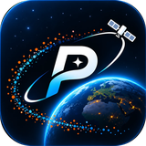
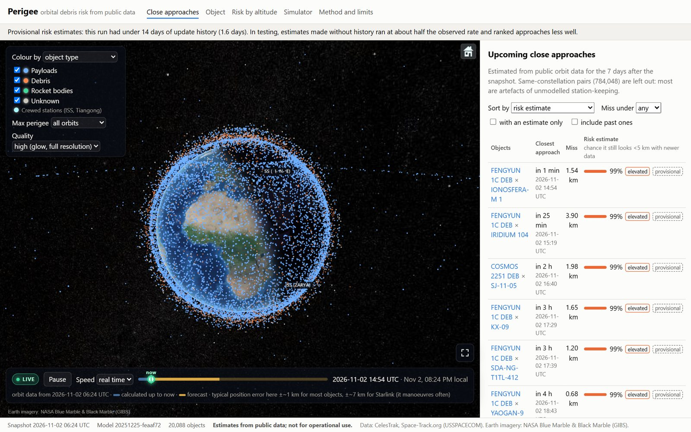
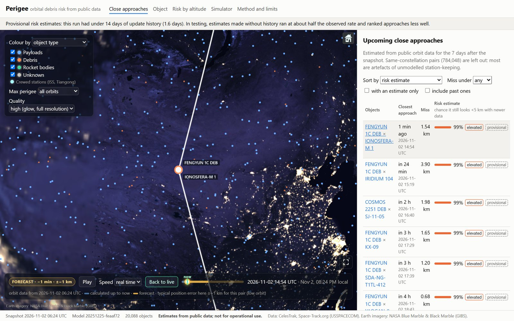
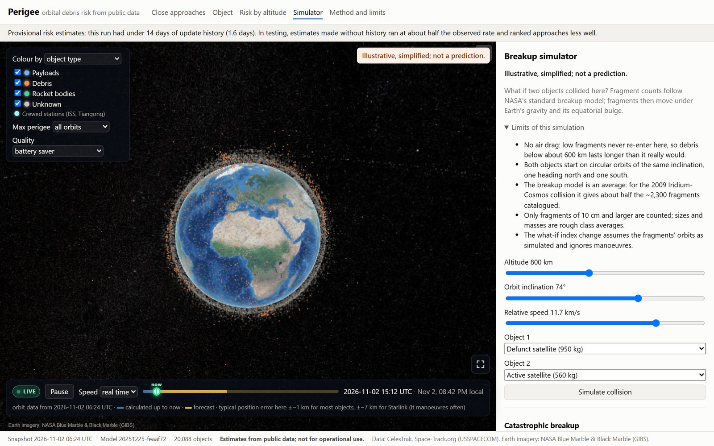
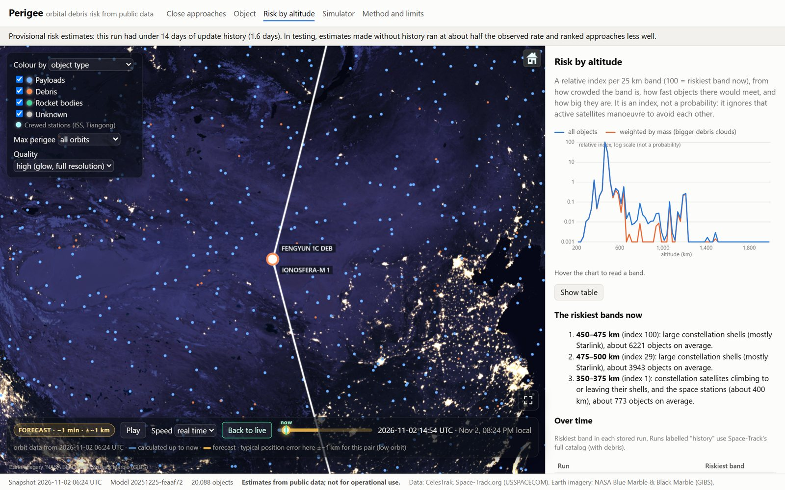
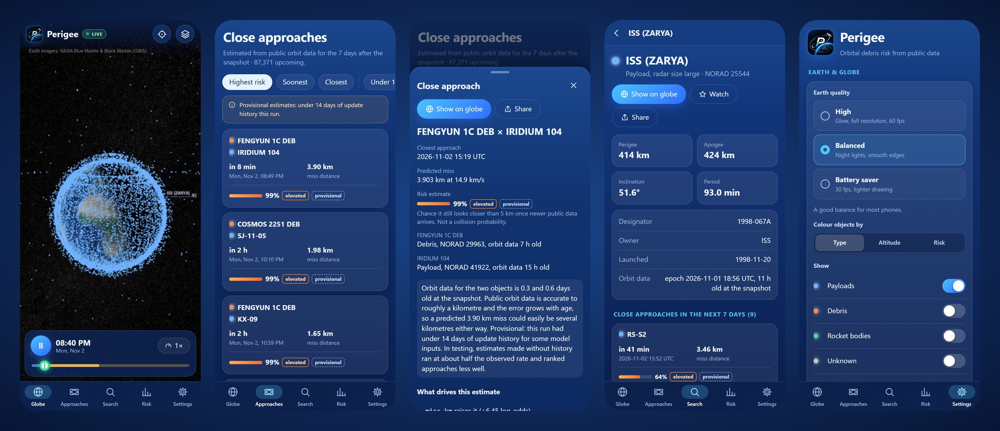
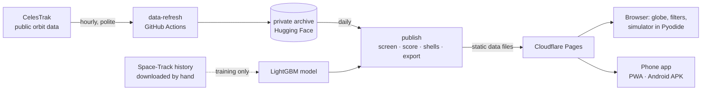
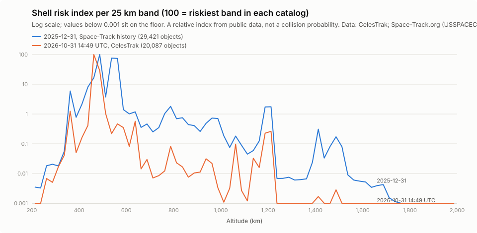

<p align="center">
  
</p>

<h1 align="center">Perigee</h1>

<p align="center">
  <strong>Orbital debris risk from public data: every tracked object on a live 3D globe, a week of
  estimated close approaches, an ML risk index, crowding by altitude and a breakup simulator.</strong>
</p>

<p align="center">
  <a href="https://perigee-space.pages.dev"><strong>Open the live site</strong></a> ·
  <a href="docs/mobile-app.md">Phone app</a> ·
  <a href="docs/model-card.md">Model card</a> ·
  <a href="#how-it-works">How it works</a>
</p>

<p align="center">
  <a href="https://github.com/aryanpol73/perigee/actions/workflows/ci.yml"></a>
  <a href="https://github.com/aryanpol73/perigee/actions/workflows/publish.yml"></a>
  <a href="https://github.com/aryanpol73/perigee/actions/workflows/data-refresh.yml"></a>
  <a href="LICENSE"></a>
</p>



> [!IMPORTANT]
> Every number here is an **estimate from public orbit data**. Public element sets carry about a kilometre of
> error and no covariance, so Perigee shows *estimated close approaches* and a *risk index*, never a claim that
> two objects will collide, and it is **not for operational decisions**.

## What it does

- **Live 3D globe.** About 20,000 objects from CelesTrak, positioned in your browser with SGP4
  (satellite.js in Web Workers) and drawn with CesiumJS over NASA Blue Marble and Black Marble imagery with
  real sunlight. Play time forward at up to 3,600×, or scrub anywhere in the data's 7-day window. The time
  bar shows the measured typical position error for the time and object you are looking at.
- **Close approaches.** The whole catalog is screened every day for pairs passing within 5 km in the next
  7 days: a KD-tree sieve, then refinement to the time of closest approach. On identical inputs it finds
  100% of CelesTrak SOCRATES's approaches.
- **ML risk index.** Public orbit data is noisy, so many flagged approaches are false alarms. A LightGBM
  model, trained on a year of Space-Track history with a strict time split, estimates the chance that an
  approach still looks closer than 5 km once newer data arrives. Its test PR-AUC is 0.70, against 0.39 for
  the best baseline.
- **Risk by altitude.** A relative crowding-and-collision index for every 25 km shell, from how full a band
  is, how fast objects there would meet and how big they are.
- **Breakup simulator.** What if two objects collided here? It uses NASA's standard breakup model, and the
  fragments are propagated under Earth's gravity and its equatorial bulge. It runs in your browser in
  Python, compiled to WebAssembly.

| Selecting an approach jumps to it | The simulator's debris cloud |
|---|---|
|  |  |



## On your phone

The site installs as an app: a home-screen PWA on Android and iPhone, or an **Android APK** (a Trusted Web
Activity). The installed app has its own phone layout:
- the globe full screen, with bottom navigation;
- approach cards with a detail sheet, and search as you type;
- a watch list, with notifications for new data and for close approaches of the objects you watch;
- settings, including Earth quality;
- offline use with the last data it saw.

The website keeps the dashboard. Details: [docs/mobile-app.md](docs/mobile-app.md).



## How it works



There is no server in production. A daily GitHub Actions job computes everything and publishes it as static
files next to the site. The browser answers every query from those files with the API's own rules: 345
recorded API answers are replayed against the static site in CI. It also runs the simulator's Python itself.
The FastAPI backend remains for local development and self-hosting. The reasoning is in
[ADR 0003](docs/decisions/0003-deployment.md).

| Part | Result | Details |
|---|---|---|
| Data pipeline | Hourly CelesTrak snapshots into a private archive; polite fetching with a hard stop on any refusal | [data-job](docs/data-job.md), [data sources](docs/data-sources.md) |
| Propagation | SGP4 matches an independent ISS reference ephemeris, and satellite.js matches Python within 50 m | [validation](docs/validation.md) |
| Screening | 100% recall against CelesTrak SOCRATES on identical inputs | [screening validation](docs/screening-validation.md) |
| ML risk index | Test PR-AUC 0.698 vs 0.386 for the best baseline (time split, late 2025) | [model card](docs/model-card.md), [ADR 0001](docs/decisions/0001-ml-task-labels-and-history.md) |
| Forecast error | Measured median position error by lead time and orbit class (about 6 km at 7 days in LEO, about 59 km for Starlink) | [forecast uncertainty](docs/forecast-uncertainty.md) |
| Shell risk index | Peaks at the constellation shells; stable month to month and across modelling choices | [risk validation](docs/risk-validation.md) |
| Breakup simulator | NASA breakup model; a collision at 800 km spreads from a point to a ring to a shell | [risk validation](docs/risk-validation.md) |
| API | Read-only FastAPI over a results bundle; reads at p95 71 ms with 20 concurrent clients | [API performance](docs/api-performance.md), [ADR 0002](docs/decisions/0002-api-results-bundle-and-simulator.md) |
| Operations | CI on every push (lint, types, 80% coverage gate, browser tests on the production build, audits, secret scan); deploy after CI; daily refresh; watchdog; one-click rollback | [deployment](docs/deployment.md), [runbook](docs/runbook.md), [threat model](docs/threat-model.md) |

**Built with:**
- **Backend:** Python 3.12, FastAPI, DuckDB, Parquet, pandas, NumPy, SciPy (cKDTree), sgp4 and LightGBM.
- **Frontend:** React, TypeScript, Vite, CesiumJS, satellite.js and Pyodide.
- **Infrastructure:** GitHub Actions, Cloudflare Pages and Hugging Face Datasets.

## Run it locally

You need Python 3.12 and Node.js 20 or newer. On Windows (elsewhere, activate with `source .venv/bin/activate`):

```bash
python -m venv .venv
.venv\Scripts\activate
pip install -r requirements-dev.txt
python -m src.main dev
```

That command starts:
- the API on http://127.0.0.1:8000 (interactive docs at `/docs`);
- the web app on http://localhost:5173 (add `?app=1` for the phone layout).

With no data of your own, it serves a small fixture bundle committed in `tests/fixtures/results` (1,798 objects
from public CelesTrak data). The first run installs the web packages.

To run with your own data, end to end:

```bash
python -m src.main data        # fetch what is due from CelesTrak, rebuild tables, print a summary
python -m src.main screen      # 7-day close-approach screen of the latest snapshot
python -m src.main shells      # altitude-band risk index for the latest snapshot
python -m src.main simulate    # illustrative breakup simulator, 800 km demo
python -m src.main train       # ML dataset, baselines, LightGBM, model card (needs history)
python -m src.main publish     # score the screen, build and validate the results bundle
python -m src.main dev         # API + web app on the published bundle
```

To run the tests:
- `python -m pytest`;
- in `web/`: `npm test` (unit tests), then `npm run e2e` (Playwright browser tests: the dashboard and the
  phone app). `PW_MODE=static npm run e2e` runs them on the production build.

## Shell risk index: sensitivity

The index is a modelling choice, so here is how much its ranking depends on those choices (end-2025 catalog,
29,421 objects; full results in [docs/risk-validation.md](docs/risk-validation.md)):

| Variant | Five riskiest 50 km regions (km) | Rank correlation with baseline |
|---|---|---|
| Baseline: 25 km bands, default sizes, sampled relative speed | 450-500, 500-550, 550-600, 400-450, 350-400 | 1.000 |
| 10 km bands | same | 0.996 |
| 50 km bands | same | 0.994 |
| Objects without a radar size class treated as medium | 450-500, 550-600, 500-550, 750-800, 400-450 | 0.965 |
| Constant 10 km/s relative speed | same as baseline | 0.998 |

Band width and the relative-speed method barely matter. The size mapping matters most. SATCAT no longer
publishes radar size for most new objects, so an assumption fills the gap: payloads and rocket bodies count as
large, debris as small. Treating them all as medium lifts the 750-800 km debris region into the top five.



## Data and credits

- Orbit data comes from [CelesTrak](https://celestrak.org) and Space-Track.org (USSPACECOM). Raw Space-Track data is used
  only for training and is never published.
- Earth imagery: NASA Blue Marble and Black Marble, served by [GIBS](https://earthdata.nasa.gov/gibs).
- Breakup model coefficients are from ESA's NASA-breakup-model-cpp.

Released under the [MIT licence](LICENSE).
