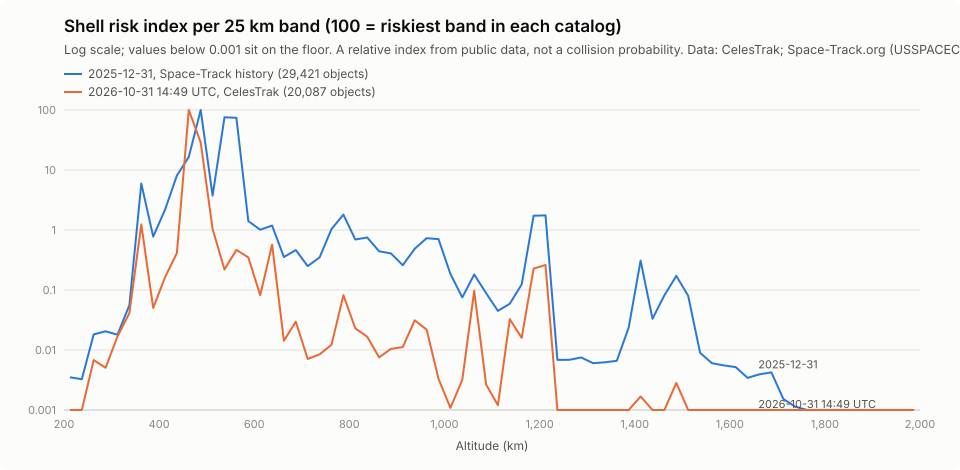

# Perigee

Orbital debris risk tracker: ingests public orbit data for about 30,000 tracked objects, screens them for
close approaches, ranks flagged approaches with an ML risk index, and scores each altitude band for
crowding and collision risk.

> Every number here is an estimate from public orbit data (about a kilometre of error, no covariance).
> It is not a collision prediction and not for operational decisions.

Data from CelesTrak and Space-Track.org (USSPACECOM). Space-Track raw data is never published.

## Status

| Part | Result | Details |
|---|---|---|
| Data pipeline | Hourly CelesTrak snapshots into a private Hugging Face dataset | [docs/data-job.md](docs/data-job.md) |
| Propagation | SGP4 matches an independent ISS reference and satellite.js | [docs/validation.md](docs/validation.md) |
| Screening | 100% recall against CelesTrak SOCRATES on identical inputs | [docs/screening-validation.md](docs/screening-validation.md) |
| ML risk index | LightGBM test PR-AUC 0.698 vs 0.386 for the best baseline (late 2025, time split) | [docs/model-card.md](docs/model-card.md) |
| Shell risk index | Peaks at the constellation shells, ~775-975 km and ~1,200-1,400 km; stable month to month | [docs/risk-validation.md](docs/risk-validation.md) |
| Breakup simulator | NASA breakup model; a collision at 800 km spreads from a point to a ring to a shell | [docs/risk-validation.md](docs/risk-validation.md) |
| API | Read-only FastAPI over a published results bundle; reads p95 71 ms with 20 concurrent clients and simulator load ([details](docs/api-performance.md)) | `/docs` when running; [ADR 0002](docs/decisions/0002-api-results-bundle-and-simulator.md) |
| Web app | React + CesiumJS globe (satellite.js in a Web Worker), close approaches, risk by altitude, simulator, method and limits | `web/` |

Deployment comes next.

## Run it locally

Needs Python 3.12 and Node.js 20 or newer. On Windows (elsewhere activate with `source .venv/bin/activate`):

```bash
python -m venv .venv
.venv\Scripts\activate
pip install -r requirements-dev.txt
```

```bash
python -m src.main dev
```

That one command starts the API on http://127.0.0.1:8000 (interactive docs at `/docs`) and the web app on
http://localhost:5173. With no data of your own it serves a small fixture bundle committed in
`tests/fixtures/results` (1,798 objects from public CelesTrak data). The first run installs the web packages.

Tests: `python -m pytest`; in `web/`, `npm test` (unit tests, including satellite.js against Python SGP4 within
50 m) and `npm run e2e` (Playwright browser journey; uses your installed Chrome).

Your own data, end to end:

```bash
python -m src.main data        # fetch what is due from CelesTrak, rebuild tables, print a summary
python -m src.main screen      # 7-day conjunction screen of the latest snapshot
python -m src.main shells      # altitude-band risk index for the latest snapshot
python -m src.main simulate    # illustrative breakup simulator, 800 km demo
python -m src.main train       # ML dataset, baselines, LightGBM, model card (needs history)
python -m src.main publish     # score the screen, build and validate the results bundle the API serves
python -m src.main dev         # API + web app on the published bundle
```

## Shell risk index: sensitivity

The index is a modelling choice, so here is how much its ranking depends on the choices (end-2025 catalog,
29,421 objects; full results in [docs/risk-validation.md](docs/risk-validation.md)):

| Variant | Five riskiest 50 km regions (km) | Rank correlation with baseline |
|---|---|---|
| Baseline: 25 km bands, default sizes, sampled relative speed | 450-500, 500-550, 550-600, 400-450, 350-400 | 1.000 |
| 10 km bands | same | 0.996 |
| 50 km bands | same | 0.994 |
| Objects without a radar size class treated as medium | 450-500, 550-600, 500-550, 750-800, 400-450 | 0.965 |
| Constant 10 km/s relative speed | same as baseline | 0.998 |

Band width and the relative-speed method barely matter. The size mapping matters most: SATCAT no longer
publishes radar size for most new objects, so an assumption fills the gap (payloads and rocket bodies large,
debris small). Treating them all as medium lifts the 750-800 km debris region into the top five.


