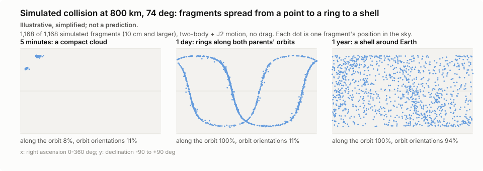

# Shell risk index and breakup simulator: validation

Generated by `scripts/validate_risk.py` in 131 s. Data from CelesTrak and Space-Track.org (USSPACECOM). The index is a relative measure from public data, never a probability; the simulator is illustrative, simplified; not a prediction.

## Method in one paragraph

25 km bands from 200 to 2,000 km. Each orbit is sampled at 72 equal time steps over one revolution and credits each band with the share of time spent in it (eccentric orbits spend longer near apogee). Mean relative speed per band comes from 4,000 random pairs meeting at a latitude both orbits reach. Cross-sections come from SATCAT radar size classes (small 0.1 m, medium 0.4 m, large 1.5 m radius); objects without a size class are assumed large if payload or rocket body and small if debris. Rate = 1/2 n^2 sigma v V, scaled so the riskiest band is 100. The weighted variant weights objects by mass^0.75.

## Shape check

End-2025 full catalog (29,421 objects from the Space-Track history). Peaks are local maxima of the log index. Riskiest band: 475-500 km.

| Expected region | Peaks found | Result |
|---|---|---|
| constellation shells, 450-600 km | 475-500 km (index 100), 525-550 km (index 75.7) | pass |
| older constellations and breakup debris, 700-1000 km | 775-800 km (index 1.81), 950-975 km (index 0.731) | pass |
| OneWeb / Globalstar, 1100-1500 km | 1200-1225 km (index 1.75), 1400-1425 km (index 0.309), 1475-1500 km (index 0.172) | pass |

Overall: **pass**. These are the regions ESA's annual Space Environment Report shows as densest; this matches shape only, not ESA's numbers.

The latest CelesTrak snapshot (2026-10-31 14:49 UTC, 20,087 objects; most small debris is not in the groups we fetch) peaks at 450-475 km: during 2026 Starlink moved many satellites from about 550 km down to about 480 km, so the top band moved with them.

## Stability check (monthly, 2025)

Spearman rank correlation of the per-band rate with the previous month. A sound index changes slowly.

| Date | Objects | Top band (km) | Top 3 regions (50 km) | Rank corr. vs previous |
|---|---|---|---|---|
| 2025-02-01 | 26,884 | 525-550 | 500-550, 550-600, 450-500 | - |
| 2025-03-01 | 27,097 | 525-550 | 500-550, 550-600, 450-500 | 0.998 |
| 2025-04-01 | 27,149 | 525-550 | 500-550, 550-600, 450-500 | 0.997 |
| 2025-05-01 | 27,179 | 525-550 | 500-550, 550-600, 450-500 | 0.996 |
| 2025-06-01 | 27,455 | 525-550 | 500-550, 550-600, 450-500 | 0.998 |
| 2025-07-01 | 27,782 | 525-550 | 500-550, 450-500, 550-600 | 0.996 |
| 2025-08-01 | 28,078 | 475-500 | 450-500, 500-550, 550-600 | 0.997 |
| 2025-09-01 | 28,279 | 475-500 | 450-500, 550-600, 500-550 | 0.995 |
| 2025-10-01 | 28,504 | 475-500 | 450-500, 550-600, 500-550 | 0.996 |
| 2025-11-01 | 28,599 | 475-500 | 450-500, 500-550, 550-600 | 0.992 |
| 2025-12-01 | 28,903 | 475-500 | 450-500, 500-550, 550-600 | 0.992 |
| 2025-12-31 | 29,421 | 475-500 | 450-500, 500-550, 550-600 | 0.987 |

Month-to-month rank correlation: min 0.987, median 0.996. The top band moves only when constellation shells are raised or lowered, which is a real change, not a data bug.

## Sensitivity (end-2025 catalog)

Each variant's five riskiest 50 km regions, and the rank correlation of its index with the baseline on a common 50 km grid (highest band in each region).

| Variant | Top 5 regions (km) | Rank corr. vs baseline |
|---|---|---|
| baseline: 25 km bands, default sizes, sampled speed | 450-500, 500-550, 550-600, 400-450, 350-400 | 1.000 |
| 10 km bands | 450-500, 500-550, 550-600, 400-450, 350-400 | 0.996 |
| 50 km bands | 450-500, 500-550, 550-600, 400-450, 350-400 | 0.994 |
| unknown sizes -> MEDIUM | 450-500, 550-600, 500-550, 750-800, 400-450 | 0.965 |
| constant 10 km/s relative speed | 450-500, 500-550, 550-600, 400-450, 350-400 | 0.998 |

The ranking of the crowded regions survives every variant; the index is a modelling choice, and the size mapping for objects without a radar size class is its weakest input.

## Breakup simulator

**Illustrative, simplified; not a prediction.**

Iridium 33 / Cosmos 2251-like collision: 560 kg and 950 kg at 11.7 km/s, 800 km, 86.4 deg.

- Specific energy 40,346.5 J/g, so catastrophic (threshold 40 J/g).
- NASA breakup model: **1,242 fragments of 10 cm or larger**. The real 2009 collision produced roughly 2,300 catalogued fragments, so the model gives about half: the same order of magnitude, which is what the guide asks of this check.
- Simulated 1,186 fragments kept in orbit; 86 got perigees below 100 km and are dropped.
- Mass: 1,510 kg in; 1,185 kg in simulated fragments; 315 kg unresolved (fragments below 10 cm and remnants); the remaining 11 kg went with the fragments that reentered at once. Fragments are dropped at random until the total is within the input mass.

Spread over time for the demo collision (same masses and speed, 800 km, both orbits at 74 deg; `spread()` in `src/sim/breakup.py`):

| After | Cloud radius (km) | Along-orbit coverage | Orbit-orientation coverage |
|---|---|---|---|
| 0.25 h | 207 | 6% | 11% |
| 1 h | 1,592 | 33% | 11% |
| 6 h | 3,309 | 61% | 11% |
| 24 h | 7,447 | 100% | 11% |
| 168 h | 7,150 | 100% | 8% |
| 720 h | 7,207 | 100% | 25% |
| 2160 h | 7,200 | 100% | 44% |
| 8760 h | 7,206 | 100% | 94% |

Point within minutes, ring within a day (fragments with slightly different periods drift apart along the orbit), shell over months (the orbit planes precess at different rates under J2). The guide expects the shell within days to weeks; with secular J2 and these delta-v values it takes months, and longer the closer the orbits are to polar, because J2 precession scales with cos(inclination):

| Inclination (deg) | Orientation coverage at 90 d | at 1 year | at 2 years |
|---|---|---|---|
| 53 | 78% | 100% | 100% |
| 74 | 44% | 94% | 100% |
| 86.4 | 19% | 42% | 67% |
| 98 | 31% | 72% | 89% |

Altitude of the demo fragments (km):

| After | 5th percentile | Median | 95th percentile |
|---|---|---|---|
| 0.25 h | 649 | 800 | 1,095 |
| 24 h | 595 | 797 | 1,435 |
| 8760 h | 532 | 803 | 1,516 |

What-if: the Iridium-Cosmos-like fragments added to the end-2025 catalog, scaled to the baseline's riskiest band; the five bands whose index rises most (relative):

| alt_lo_km | alt_hi_km | risk_index_before | risk_index_after | change_pct |
|---|---|---|---|---|
| 800.0 | 825.0 | 0.694 | 0.87 | 25.276 |
| 775.0 | 800.0 | 1.805 | 2.166 | 19.951 |
| 825.0 | 850.0 | 0.749 | 0.83 | 10.823 |
| 750.0 | 775.0 | 1.035 | 1.137 | 9.842 |
| 725.0 | 750.0 | 0.349 | 0.38 | 8.905 |

## Limits

- No drag: low fragments do not decay, so long-term altitude spread is overstated below about 600 km.
- Both parents start on circular orbits of the same inclination, one heading north and one south; real geometry differs.
- The index counts each object's time in a band, not its actual encounters; active satellites manoeuvre to avoid collisions, which the index ignores.
